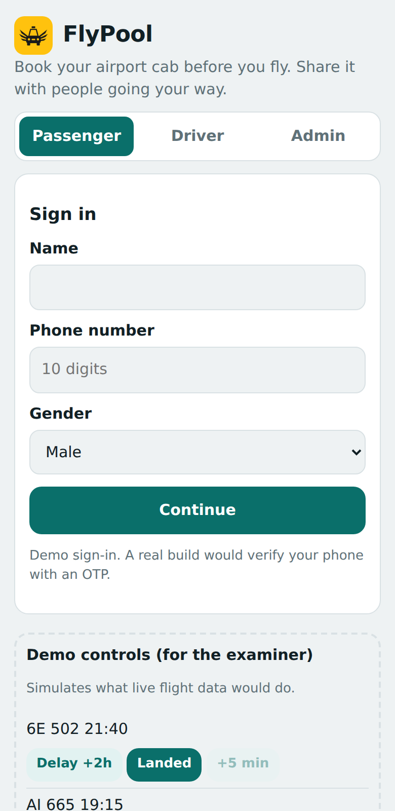
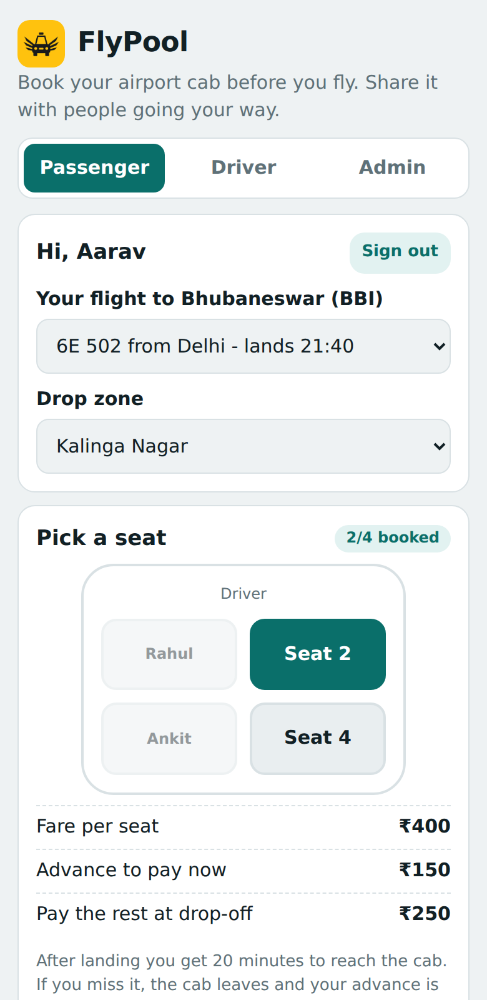
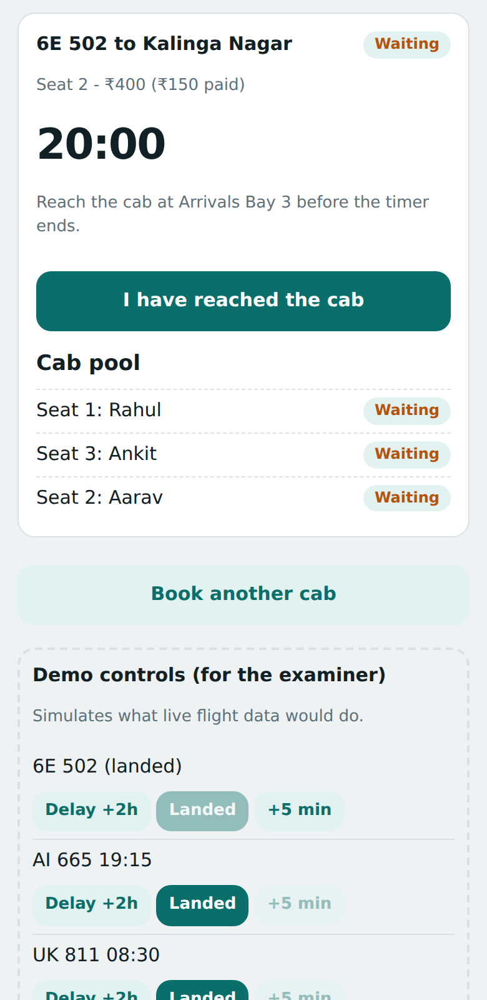
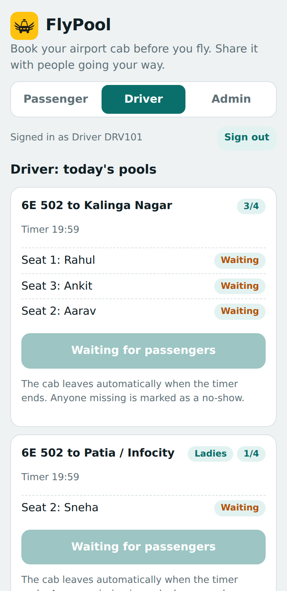
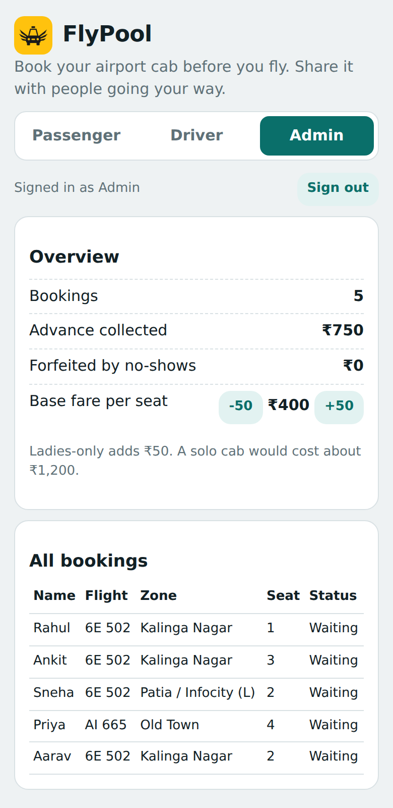

<p align="center"></p>

<h1 align="center">FlyPool</h1>
<p align="center"><b>Pre-book a shared airport cab. Land, grab your bags, and ride with people going your way.</b></p>

> A college project prototype for Bhubaneswar Airport (BBI). It runs fully in the browser with mock data. No real payments, flights or cabs are involved.

**Live demo:** `https://sharmaak2704-dev.github.io/flypool/` (replace with your own GitHub Pages link)

## The problem

After a flight lands, dozens of passengers book separate cabs to nearly the same part of the city. Each person pays for a whole car (around ₹1,200 for a premium cab) while the other seats go empty.

## The idea

Passengers **pre-book a seat** before they fly, using their flight number and drop zone. Everyone on the same flight going to the same zone shares one cab, up to 4 people.

| | Solo premium cab | FlyPool seat |
|---|---|---|
| Cost per person | about ₹1,200 | about ₹400 |
| Driver earns | one fare | up to 4 fares |
| Waiting | none | fixed 20-minute window |

## Features

- **Passenger:** sign in, pick a flight and zone, choose a seat on a 4-seat car, pay a ₹150 advance (test mode), and tap **I have reached the cab**.
- **20-minute rule:** the timer starts when the flight lands. When it ends, the cab leaves and anyone missing is marked as a no-show and loses the advance.
- **Flight delays:** if a flight is delayed, the pickup time moves automatically and the passenger is told.
- **Ladies-only cab:** a women-only pool at a small extra charge (+₹50).
- **Driver view:** shows every pool, who has reached the cab, and unlocks **Start trip** when everyone is present.
- **Admin view:** all bookings, advance collected, forfeited advances, and an adjustable base fare.
- **Installable (PWA):** adds to the phone home screen and works offline.

## Screenshots

<p>
  
</p>
<p>
 
</p>

## Try it

Open the live demo or `index.html` in a browser.

| Role | Login |
|---|---|
| Passenger | any name and a 10-digit number |
| Driver | `DRV101` / `1234` |
| Admin | `admin` / `admin123` |

**Quick demo (about 2 minutes):**
1. As a passenger, book a seat on flight 6E 502 and pay the advance.
2. In **Demo controls** at the bottom, press **Delay +2h** to see the pickup time change, then **Landed** to start the 20-minute timer.
3. Switch to **Driver** and watch the passenger list. Use **+5 min** in the demo controls to run the timer down.
4. When the timer ends, anyone who did not tap **I have reached the cab** is marked as a no-show and loses the advance.
5. Open **Admin** to see collected and forfeited money.

## Tech

- Plain HTML, CSS and JavaScript in a single `index.html`, with no build step and no dependencies.
- PWA: `manifest.json` and `sw.js` for installing and offline use.

```
flypool/
├── index.html       the whole app
├── manifest.json    PWA install details
├── sw.js            offline cache
├── icon-192.png     app icon
├── icon-512.png     app icon
└── screenshots/     images used in this README
```

## Run locally

```bash
git clone https://github.com/sharmaak2704-dev/flypool.git
cd flypool
python3 -m http.server 8000   # then open http://localhost:8000
```

You can also just double-click `index.html`. The offline cache only works over `http://` or `https://`.

## Limitations (prototype)

- Data is kept in the browser tab and resets on reload. Each device has its own copy, so a booking on one phone does not appear on another.
- Flights are mock data and the demo controls simulate landings and delays.
- Payments are simulated, and the logins are fixed demo accounts, so they are not secure.

## Future scope

- Live flight data from a flight status API
- Real payments (for example Razorpay) and phone OTP login
- A shared backend (for example Firebase) so passengers, drivers and admins use separate phones live
- Route and zone maps, live ride tracking and an SOS button
- More airports, city-to-airport rides, and licensing with registered cab operators

## License

MIT. See [LICENSE](LICENSE).
